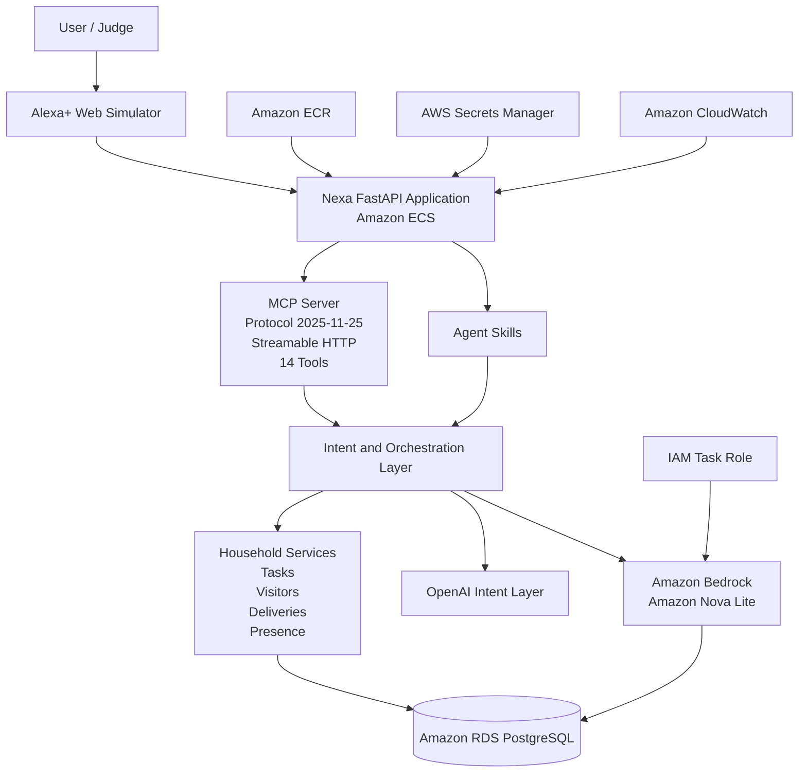

# Nexa

**Nexa** is a household intelligence agent built for the **Alexa+ MCP track** and the **AWS Builder mini challenge**.

It gives households a conversational interface for understanding and managing everyday home activity, including:

- Household presence
- Visitors
- Deliveries
- Tasks
- Household briefings

Nexa exposes these capabilities through a self-hosted **Model Context Protocol (MCP)** server using **Streamable HTTP**, persists production household state in **Amazon RDS PostgreSQL**, and uses **Amazon Bedrock with Amazon Nova Lite** to generate concise household briefings from live household data.

---

## Highlights

- Self-hosted MCP server
- MCP protocol version **2025-11-25**
- **Streamable HTTP** transport
- **14 MCP tools**
- Alexa+ style web simulator
- Open-standard Agent Skills
- Confirmation-gated write actions
- Amazon Bedrock + Amazon Nova Lite
- Amazon ECS deployment
- Amazon RDS PostgreSQL persistence
- Amazon ECR container images
- AWS Secrets Manager
- Amazon CloudWatch logging
- IAM task role for Bedrock access
- Automated test suite
- Production-oriented household state management

---

# Live Demo

## Alexa+ Web Simulator

```text
https://ne-cc084a3067bf4a9bbe7c0a4bc5e5ffee.ecs.us-east-1.on.aws/simulator
```

## MCP Streamable HTTP Endpoint

```text
https://ne-cc084a3067bf4a9bbe7c0a4bc5e5ffee.ecs.us-east-1.on.aws/mcp/
```

---

# What Nexa Does

Nexa maintains structured household state and allows users to interact with that state through natural language.

Example requests:

```text
Who is home?

What tasks are open?

What deliveries are pending?

Is anyone expected to visit today?

Give me a home update.

Create a task to call the electrician tomorrow.

Complete the electrician task.

Mark the MacBook Pro as delivered.

Mark Ada Okafor as arrived.

Set Obumneme to away.
```

Read operations can execute immediately.

State-changing actions use a confirmation-first workflow before household state is modified.

Example:

```text
User:
Create a task to service the generator.

Nexa:
Create the task 'Service the generator'?

User:
Yes, confirm.

Nexa:
Task created: Service the generator.
```

---

# Alexa+ / MCP Integration

Nexa includes a self-hosted MCP server implemented with the **MCP Python SDK**.

The MCP server supports:

- MCP initialization
- Protocol negotiation
- Tool discovery
- Tool execution
- Streamable HTTP
- Natural-language orchestration
- Confirmation-gated state changes

The public MCP endpoint is designed around:

```text
Protocol Version: 2025-11-25
Transport: Streamable HTTP
Tools: 14
```

This implementation provides the core requirements needed for an Alexa+ compatible MCP integration.

---

# MCP Tools

Nexa currently exposes the following MCP tools:

1. `nexa_status`
2. `get_household_presence`
3. `get_expected_visitors`
4. `get_pending_deliveries`
5. `get_open_tasks`
6. `get_household_briefing`
7. `create_task`
8. `complete_task`
9. `cancel_visitor`
10. `mark_visitor_arrived`
11. `mark_visitor_departed`
12. `mark_delivery_delivered`
13. `mark_delivery_collected`
14. `update_presence`

The tools connect to Nexa's application services and persistent household state rather than returning hard-coded demo responses.

---

# Alexa+ Simulated Experience

Nexa includes a browser-based Alexa+ style simulator for demonstrating the product without requiring physical Alexa hardware.

Example interaction:

```text
User:
Who is home?

Nexa:
Obumneme is currently at home.
```

Another example:

```text
User:
What tasks are open?

Nexa:
You have one open task: Call the electrician tomorrow.
```

Delivery example:

```text
User:
What deliveries are pending?

Nexa:
You have one pending DHL delivery: MacBook Pro.
```

Household briefing example:

```text
User:
Give me a home update.
```

Example response:

```text
Obumneme is home. Ada Okafor is expected for a family visit.
A MacBook Pro delivery from DHL is expected later today.
```

The simulator source code is included in the repository.

---

# Amazon Bedrock Integration

Nexa includes a real **Amazon Bedrock** integration for AI-generated household briefings.

The `get_household_briefing` MCP tool:

1. Reads the current household state
2. Structures the relevant household context
3. Sends that context to Amazon Bedrock
4. Uses Amazon Nova Lite to generate a concise briefing
5. Returns the result to the user

Configuration:

```text
Provider: Amazon Bedrock
Model: Amazon Nova Lite
Region: us-east-1
Model ID: amazon.nova-lite-v1:0
```

The model is instructed to:

- Use only supplied household information
- Avoid inventing facts
- Produce concise household summaries
- Prioritize useful and timely information

Example request:

```text
Give me a home update.
```

Example response:

```text
Obumneme is home. Ada Okafor is expected for a family visit.
A MacBook Pro delivery from DHL is expected later today.
```

---

# Agent Skills

Nexa includes open-standard Agent Skill definitions under:

```text
.agents/skills/
```

Current skills include:

```text
.agents/skills/
├── household-status/
├── task-management/
├── visitor-management/
├── delivery-management/
└── presence-management/
```

These skills provide instructions and context for interpreting household requests and mapping them to Nexa capabilities.

They cover:

- Household status
- Household task management
- Visitor management
- Delivery management
- Household presence

---

# Safe Write-Action Flow

Nexa separates language understanding from execution.

For state-changing requests, Nexa uses the following workflow:

```text
User request
      ↓
Intent resolution
      ↓
MCP tool selected
      ↓
Confirmation required
      ↓
User confirms
      ↓
Action executes
      ↓
Persistent state updates
```

Example:

```text
User:
Mark the MacBook Pro as delivered.

Nexa:
Mark 'MacBook Pro' as delivered?

User:
Yes, confirm.

Nexa:
Delivery marked as delivered: MacBook Pro.
```

This design helps prevent accidental changes to household state.

---

# AWS Architecture

Nexa uses several AWS services in the production architecture.

## Amazon ECS

The Nexa application is deployed on Amazon ECS.

The ECS-hosted application includes:

- FastAPI backend
- MCP server
- Alexa+ simulator
- Household APIs
- Conversational orchestration
- Bedrock-enabled household briefings

## Amazon ECR

Docker container images are stored in **Amazon Elastic Container Registry**.

## Amazon RDS PostgreSQL

Production household state is stored in **Amazon RDS PostgreSQL**.

The database stores information such as:

- Household presence
- Expected visitors
- Deliveries
- Household tasks
- Home events
- Conversation state

## AWS Secrets Manager

Sensitive runtime configuration is stored outside the source code using AWS Secrets Manager.

Examples include:

- PostgreSQL credentials
- External API credentials
- Production secrets

## Amazon CloudWatch

CloudWatch is used for application and ECS logging.

It is useful for observing:

- Application startup
- Database migrations
- PostgreSQL connectivity
- MCP activity
- ECS deployment health
- Runtime errors

## IAM

Nexa uses an ECS task IAM role for Bedrock access.

The application can invoke:

```text
amazon.nova-lite-v1:0
```

using:

```text
bedrock:InvokeModel
```

This avoids embedding AWS access credentials directly in the application.

---

# Architecture Diagram



---

# Technology Stack

## Backend

- Python
- FastAPI
- SQLAlchemy
- Alembic
- Pydantic
- Uvicorn

## AI and Agents

- MCP Python SDK
- OpenAI API
- Amazon Bedrock
- Amazon Nova Lite
- Agent Skills

## Database

- Amazon RDS PostgreSQL
- SQLite for local development

## AWS

- Amazon ECS
- Amazon ECR
- Amazon RDS
- Amazon Bedrock
- AWS Secrets Manager
- Amazon CloudWatch
- IAM

## Development

- Docker
- Pytest
- Ruff
- PowerShell
- GitHub

---

# Repository Structure

```text
nexa/
├── .agents/
│   └── skills/
│       ├── household-status/
│       │   └── SKILL.md
│       ├── task-management/
│       │   └── SKILL.md
│       ├── visitor-management/
│       │   └── SKILL.md
│       ├── delivery-management/
│       │   └── SKILL.md
│       └── presence-management/
│           └── SKILL.md
│
├── services/
│   └── api/
│       ├── migrations/
│       ├── src/
│       │   └── nexa_api/
│       │       ├── agent_routes.py
│       │       ├── agent_service.py
│       │       ├── bedrock_service.py
│       │       ├── config.py
│       │       ├── database.py
│       │       ├── delivery_routes.py
│       │       ├── delivery_service.py
│       │       ├── mcp_executor.py
│       │       ├── mcp_orchestrator.py
│       │       ├── mcp_server.py
│       │       ├── models.py
│       │       ├── presence_routes.py
│       │       ├── presence_service.py
│       │       ├── schemas.py
│       │       ├── simulator_routes.py
│       │       ├── simulator_ui.py
│       │       ├── skill_loader.py
│       │       ├── skill_selector.py
│       │       ├── task_routes.py
│       │       ├── task_service.py
│       │       ├── visitor_routes.py
│       │       └── visitor_service.py
│       │
│       ├── tests/
│       ├── Dockerfile
│       ├── alembic.ini
│       ├── pyproject.toml
│       ├── public_mcp_test.py
│       └── test_bedrock.py
│
└── README.md
```

---

# Local Setup

## 1. Clone the Repository

```bash
git clone https://github.com/Obumezi/nexa.git
cd nexa/services/api
```

---

## 2. Create a Virtual Environment

### Windows PowerShell

```powershell
python -m venv .venv
.venv\Scripts\Activate.ps1
```

### Linux / macOS

```bash
python3 -m venv .venv
source .venv/bin/activate
```

---

## 3. Install Dependencies

Install the application:

```powershell
pip install -e .
```

Install development dependencies:

```powershell
pip install -e ".[dev]"
```

If your AWS credential provider requires AWS CRT:

```powershell
pip install "botocore[crt]"
```

---

# Environment Configuration

Nexa uses the `NEXA_` prefix for application environment variables.

Example local configuration:

```text
NEXA_ENVIRONMENT=development
NEXA_DATABASE_URL=sqlite:///./nexa.db

NEXA_OPENAI_API_KEY=
NEXA_OPENAI_MODEL=

NEXA_BEDROCK_REGION=us-east-1
NEXA_BEDROCK_MODEL_ID=amazon.nova-lite-v1:0
```

AWS credentials should be configured using the AWS CLI or another supported AWS credential provider.

Never commit:

```text
AWS credentials
OpenAI API keys
Database passwords
Secrets Manager values
Production .env files
```

---

# Database Setup

Run database migrations:

```powershell
alembic upgrade head
```

Local development uses:

```text
SQLite
```

Production uses:

```text
Amazon RDS PostgreSQL
```

---

# Run Nexa Locally

Start the FastAPI application:

```powershell
uvicorn nexa_api.main:app --reload --port 8000
```

Simulator:

```text
http://127.0.0.1:8000/simulator
```

Local MCP endpoint:

```text
http://127.0.0.1:8000/mcp/
```

Health endpoint:

```text
http://127.0.0.1:8000/health
```

---

# Testing

## Ruff

Run static checks:

```powershell
ruff check src tests
```

## Pytest

Run the complete test suite:

```powershell
pytest --basetemp=.pytest_tmp
```

A recent local test run collected:

```text
273 tests
269 passed
4 failed
```

The four failures were all from:

```text
tests/test_mcp_e2e_live.py
```

and reported:

```text
ConnectError: All connection attempts failed
```

These tests depend on a reachable live MCP server.

Before running the live MCP end-to-end tests locally, start the Nexa application:

```powershell
uvicorn nexa_api.main:app --reload --port 8000
```

Then run:

```powershell
pytest tests/test_mcp_e2e_live.py --basetemp=.pytest_tmp
```

---

# Public MCP Verification

The repository includes:

```text
services/api/public_mcp_test.py
```

Run:

```powershell
python .\public_mcp_test.py
```

The verification script is intended to test:

- MCP initialization
- Protocol negotiation
- Tool discovery
- Household state reads
- Tool execution
- Persistent state interaction

---

# Amazon Bedrock Verification

A Bedrock integration test is available at:

```text
services/api/test_bedrock.py
```

Run:

```powershell
python .\test_bedrock.py
```

Example household briefing:

```text
Obumneme is home, and Ada Okafor is visiting for family.
A MacBook Pro delivery from DHL is expected, and an electrician
call is scheduled for tomorrow.
```

---

# Suggested Demo Flow

A strong judge-facing demo can follow this sequence.

## 1. Check household presence

```text
Who is home?
```

Example response:

```text
Obumneme is currently at home.
```

## 2. Check deliveries

```text
What deliveries are pending?
```

Example response:

```text
You have one pending DHL delivery: MacBook Pro.
```

## 3. Generate an AI household briefing

```text
Give me a home update.
```

This demonstrates the Amazon Bedrock + Nova Lite integration.

## 4. Create a household task

```text
Create a task to service the generator.
```

Nexa should request confirmation.

## 5. Confirm the write action

```text
Yes, confirm.
```

## 6. Verify the new state

```text
What tasks are open?
```

The newly created task should appear.

This demo demonstrates:

- Natural-language interaction
- Alexa+ style experience
- MCP reads
- MCP writes
- Confirmation-based safety
- Amazon Bedrock
- Persistent household state
- End-to-end orchestration

---

# Security and Safety

Nexa is designed around explicit execution boundaries.

## Read Actions

Read operations can execute immediately.

Examples:

- Get household presence
- List expected visitors
- List pending deliveries
- List open tasks
- Generate a household briefing

## Write Actions

State-changing actions require confirmation.

Examples:

- Create a task
- Complete a task
- Cancel a visitor
- Mark visitor arrived
- Mark visitor departed
- Mark delivery delivered
- Mark delivery collected
- Update household presence

## Secrets

Production secrets are kept outside the source repository.

AWS Secrets Manager is used for sensitive production configuration.

## Database

Production household state is stored in Amazon RDS PostgreSQL rather than container-local storage.

## AWS Permissions

Amazon Bedrock permissions are granted to the ECS task through IAM rather than hard-coded AWS credentials.

---

# Persistence

Nexa's production architecture uses **Amazon RDS PostgreSQL** for persistent household state.

This means application state is separated from the ECS container lifecycle.

The application can therefore restart or replace ECS tasks without relying on local container storage for household records.

---

# Alexa+ Track

Nexa was built for the **Alexa+** track.

Its Alexa+ focused capabilities include:

- Self-hosted MCP server
- MCP protocol version 2025-11-25
- Streamable HTTP
- MCP Python SDK
- Public MCP endpoint
- MCP tool discovery
- MCP tool execution
- Agent Skills
- Alexa+ style web simulator
- Confirmation-based state changes
- Persistent household data

---

# AWS Builder Mini Challenge

Nexa also targets the **AWS Builder mini challenge**.

Amazon Bedrock is integrated into the product through the:

```text
get_household_briefing
```

MCP tool.

The workflow is:

```text
Live household state
        ↓
Structured household context
        ↓
Amazon Bedrock
        ↓
Amazon Nova Lite
        ↓
Natural-language household briefing
```

Additional AWS services used by Nexa include:

- Amazon ECS
- Amazon ECR
- Amazon RDS PostgreSQL
- AWS Secrets Manager
- Amazon CloudWatch
- IAM

---

# Built During the Hackathon

Nexa was developed as a working household intelligence platform during the hackathon.

Major implementation areas include:

- Household data model
- Household presence
- Visitor management
- Delivery management
- Household task management
- Home events
- Conversational intent resolution
- MCP server
- Streamable HTTP transport
- 14 MCP tools
- Agent Skills
- Confirmation-gated write actions
- Alexa+ style simulator
- Docker deployment
- Amazon ECS
- Amazon RDS PostgreSQL
- Amazon ECR
- AWS Secrets Manager
- Amazon CloudWatch
- IAM task permissions
- Amazon Bedrock
- Amazon Nova Lite
- Automated testing

---

# Demo Data

A simple demo household can contain:

```text
Presence:
Obumneme → home

Visitor:
Ada Okafor → expected

Delivery:
DHL MacBook Pro → expected

Task:
Call the electrician tomorrow → open
```

This gives judges a predictable household state for demonstrating Nexa.

---

# Engineering Notes

Some engineering challenges encountered during development included:

- Running MCP live tests against an active local MCP endpoint
- ECS task-role configuration for Bedrock
- AWS credential-provider dependencies
- Production RDS configuration
- Secrets Manager runtime injection
- ECS deployment troubleshooting
- Persistent-state validation
- MCP Streamable HTTP integration
- ECS task-definition revisions

These challenges influenced the final production architecture.

---

# Hackathon Entry

## Primary Track

**Alexa+**

Nexa provides a self-hosted MCP integration and an Alexa+ style simulated experience.

## Mini Challenge

**AWS Builder**

Nexa uses Amazon Bedrock with Amazon Nova Lite as a user-facing AI capability.

---

# License

Choose the licensing approach required for your final hackathon submission.

For a public repository, an open-source license such as the **MIT License** can be added as:

```text
LICENSE
```

If the repository remains private, provide reviewer access according to the hackathon submission requirements.

---

# Author

Built for the Amazon Developer Hackathon.

**Project:** Nexa  
**Primary Track:** Alexa+  
**Mini Challenge:** AWS Builder
